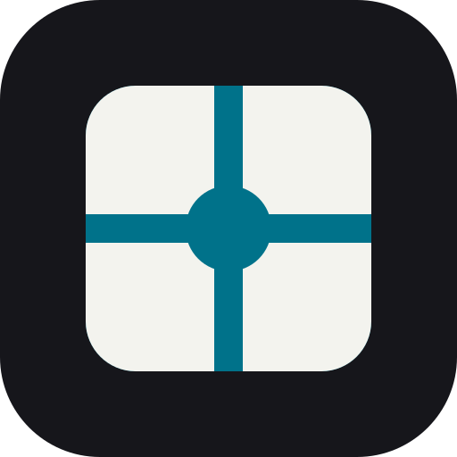
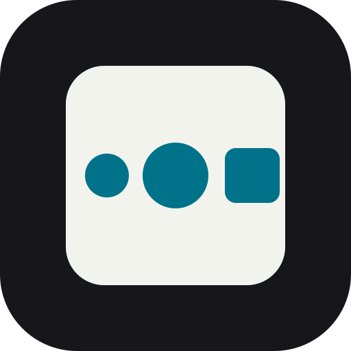
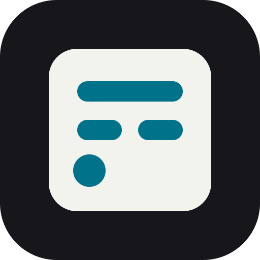
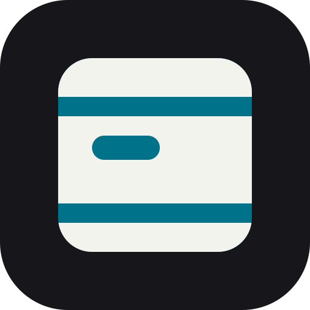
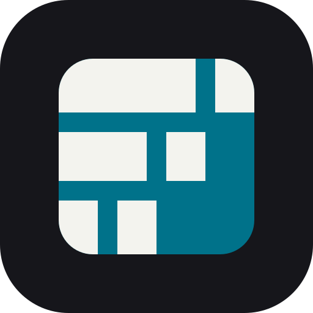
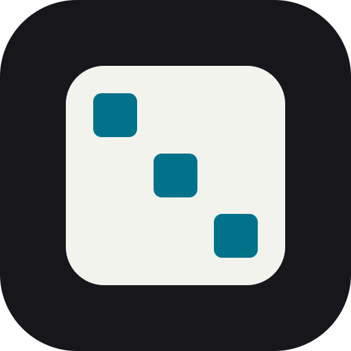
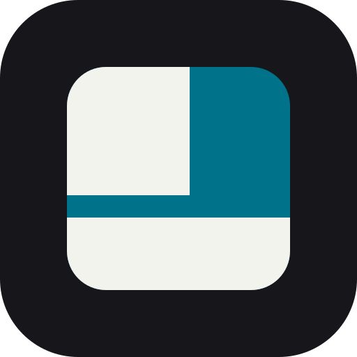
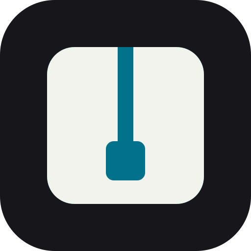

# Marca de Nexa Squad

Nexa no fabrica piezas: acomoda las que ya existen. Por eso todos los símbolos son **el mismo bloque**, y lo que cambia es **el hueco**: el lugar exacto donde algo encaja. Cada hueco sale de lo que su agente hace según su `skills/<agente>/SKILL.md`.

| | Agente | El hueco |
|---|---|---|
|  | **Nexa Squad** | Dos canales que se cruzan en un nexo redondo: cada decisión tiene un dueño y todas se encuentran en el módulo. |
|  | **Orka** · Conductor | Una cadena de tres huecos: hecho, actual y pendiente. Un rol a la vez. |
|  | **Inqa** · Product Analyst | Un renglón entero (hecho), uno partido (supuesto) y un punto (pregunta). |
|  | **Arko** · Systems Architect | Una cerradura: solo pasa lo que el servidor permite. |
|  | **Fluxa** · Flow Designer | Una pantalla tallada: cabecera, herramientas, datos y pie. |
|  | **Kompa** · Layout Composer | La misma fila en tres anchos: el tramo final nunca cede. |
|  | **Kura** · Component Curator | El mismo hueco en tres lugares: ya toca un componente. |
|  | **Forja** · Build Engineer | La base completa y la capa de arriba a medias. |
|  | **Vera** · QA Auditor | Un hallazgo que sube por su canal hasta su dueño. |

## Reglas

- **Construcción:** lienzo de 48, bloque 40 × 40 con radio 7, retícula de 4. Canales de 4, huecos de 8 y círculos de radio 4 como mínimo (siguen visibles a 16 px). Tres cortes como máximo; la excepción es Kompa.
- **Color:** el bloque siempre es neutro y el cian vive solo dentro del hueco.
  - Claro: bloque tinta `#16161B`, hueco cian `#22C3E6` (8.6:1 contra el bloque).
  - Oscuro: bloque claro `#F3F3EE`, hueco cian oscuro `#00728A` (5.0:1 contra el bloque).
  - Nunca cian claro sobre bloque claro, nunca un color distinto por agente; el hueco, no el color, distingue a cada agente.
- **Letra:** Bricolage Grotesque (SIL Open Font, Google Fonts), 700 para el nombre y 400 para el producto. En las firmas va convertida a trazos.
- **Plataformas:** Claude Code, Codex y Kiro se nombran en texto, nunca con sus logotipos dentro de la marca.

## Archivos

| Ruta | Qué es |
|---|---|
| `<agente>/simbolo.svg`, `simbolo-oscuro.svg` | Símbolo para fondo claro y oscuro |
| `<agente>/simbolo-tinta.svg` | Una sola tinta (`currentColor`), hueco transparente |
| `<agente>/lockup.svg`, `lockup-oscuro.svg` | Símbolo + nombre + producto |
| `<agente>/app-icon.svg`, `app-icon-512.png`, `app-icon-192.png` | Icono de app |
| `<agente>/favicon.svg` | Favicon que cambia con el tema del sistema |
| `kit/<agente>-og-1200x630.png` | Portada Open Graph |
| `kit/<agente>-social-1280x640.png` | Vista previa social de GitHub (Settings → Social preview) |
| `tema.json` | Colores, contrastes, construcción, reglas y productos |
| `textos.md` | Lema y descripción por producto, en español e inglés |

Los archivos se generan desde los scripts de marca en el repositorio de Fruti Squad (`.fruti/icons/nexa-squad/`); si cambias algo, regenéralo allí y vuelve a copiarlo para que no se desfasen.
